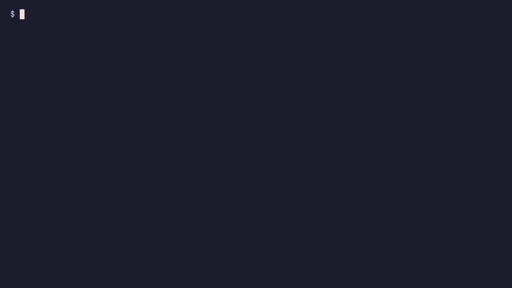
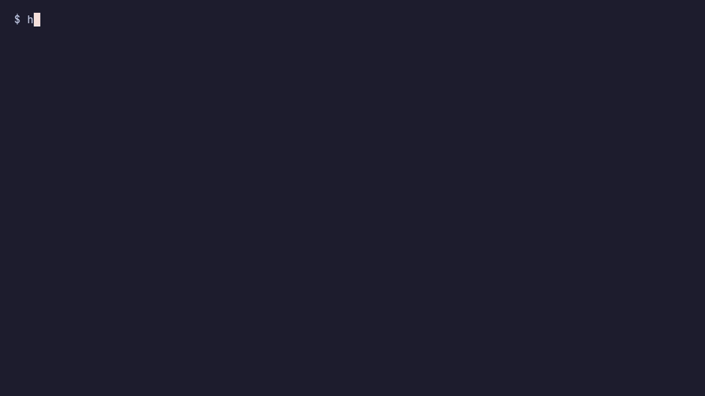

# Stop writing Helm charts

Example project for the Quarkus Club post about the
[Quarkus Helm](https://github.com/quarkiverse/quarkus-helm) extension.

`orders-api` is a small REST API backed by PostgreSQL. Its Helm chart is never
written by hand: the extension generates it during the build from
`src/main/resources/application.properties`.

## What the chart covers

| Concern | Where it comes from | Chart value |
|---|---|---|
| Database URL and credentials | `${POSTGRESQL_URL:...}` style properties | `app.envs.*` |
| Health probes | `quarkus-smallrye-health` extension | `app.livenessProbe`, `app.readinessProbe`, `app.startupProbe` |
| Ingress host | `quarkus.kubernetes.ingress.host` | `app.host` |
| Replicas (minimum of 2) | `quarkus.kubernetes.replicas` and `quarkus.helm.values-schema.*` | `app.replicas` |
| Memory limit | `quarkus.helm.values.memoryLimit.paths` | `app.memoryLimit` |

## Requirements

- JDK 21 and Docker
- [Helm](https://helm.sh/docs/intro/install/)
- [minikube](https://minikube.sigs.k8s.io/) and `kubectl`, only for the cluster steps

## Generate the chart

```bash
./mvnw clean package
```

The chart is written to `target/helm/kubernetes/orders-api/`.

## Validate without a cluster

```bash
cd target/helm/kubernetes

helm lint orders-api

helm template orders orders-api \
    --set app.replicas=4 \
    --set app.memoryLimit=1Gi \
    --set app.host=orders.mycompany.com

# Rejected by the generated schema: replicas has a minimum of 2
helm template orders orders-api --set app.replicas=1
```



## Install on minikube

Build the image straight into minikube's Docker daemon, so no registry is
needed. `image-pull-policy=IfNotPresent` makes Kubernetes use that local image
instead of trying to pull it.

```bash
minikube start
eval $(minikube docker-env)

./mvnw clean package \
    -Dquarkus.container-image.build=true \
    -Dquarkus.kubernetes.image-pull-policy=IfNotPresent

kubectl apply -f k8s/postgres.yaml
kubectl rollout status deployment/postgres

helm install orders target/helm/kubernetes/orders-api
kubectl rollout status deployment/orders-api
```

Call the API:

```bash
kubectl port-forward svc/orders-api 8080:80

curl -X POST localhost:8080/orders \
    -H 'Content-Type: application/json' \
    -d '{"customer":"Ana","product":"Keyboard","quantity":2}'

curl localhost:8080/orders
```

Scale without rebuilding, then clean up:

```bash
helm upgrade orders target/helm/kubernetes/orders-api --reuse-values --set app.replicas=3

helm uninstall orders
kubectl delete -f k8s/postgres.yaml
```



## Re-recording the GIFs

The GIFs are recorded with [VHS](https://github.com/charmbracelet/vhs) through
its Docker image, so nothing has to be installed:

```bash
vhs/record.sh vhs/validate.tape
vhs/record.sh vhs/install.tape   # needs the cluster, the image and PostgreSQL
```
